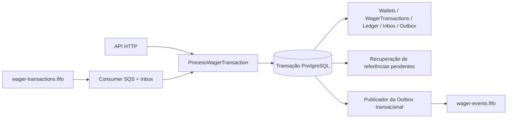

# Arquitetura

## Visão geral do sistema

O endpoint HTTP e o consumer SQS chamam o mesmo processador financeiro da aplicação. O estado financeiro e a Outbox são confirmados no banco antes de qualquer evento externo ser publicado.



A implementação usa limites pragmáticos entre domínio, aplicação e infraestrutura, além de adapters para os transportes. As classes de domínio Money, Wallet, Ledger e WagerTransaction não dependem de NestJS nem de MikroORM. Records de infraestrutura e mappers explícitos fazem a ligação com o PostgreSQL.

## Estrutura do projeto

```text
src/
  wallet/         Domínio Wallet, casos de uso de criação/consulta/reconciliação e adapters HTTP/persistência
  wagering/       Domínio WagerTransaction, processador, adapters HTTP/SQS e recuperação
  outbox/          Persistência de eventos de integração e publicador
  infrastructure/ Configuração, mappings/migrations do banco, logs, métricas e clientes SQS
  shared/          Valores compartilhados de domínio e suporte de aplicação/HTTP
  health/           Liveness e prontidão das dependências
test/               Harnesses unitários, integração PostgreSQL/LocalStack, distribuído e de carga
docker/             Provisionamento de filas do LocalStack
```

## Money e limites de persistência

Money é representado pelo value object imutável `Money`, implementado internamente com decimal.js. `number` do JavaScript nunca é usado para aritmética monetária. Valores externos são strings decimais com exatamente duas casas; notação científica, valores externos negativos e formatos inválidos são rejeitados. Currency é um código de três letras maiúsculas; operações entre currencies diferentes geram erro de domínio.

O value object Money genérico mantém precisão Decimal exata independentemente do banco. Estados financeiros persistíveis possuem um limite separado, compatível com PostgreSQL `NUMERIC(20,2)`, cujo máximo não negativo é `999999999999999999.99`. Os mappers preservam strings decimais nos dois sentidos; os valores não passam por números IEEE-754. O banco também valida precisão numérica, formato de currency e valores não negativos de Wallet/Ledger.

Operações internas de Money podem produzir valores negativos, por exemplo `storedBalance - calculatedBalance` na reconciliação. Esses valores não são aceitos como valores externos de transação nem como saldo de Wallet.

## Concorrência da Wallet e limites transacionais

Operações financeiras usam um EntityManager MikroORM separado por fork e uma transação PostgreSQL. Antes de tomar a decisão final de saldo, o processador bloqueia a linha da Wallet com `SELECT ... FOR UPDATE` / `LockMode.PESSIMISTIC_WRITE`. Dentro da proteção, revalida a identidade persistida, aplica a operação de domínio e persiste transaction, alteração de Wallet quando aplicável, Ledger e Outbox antes do commit.

```text
BEGIN
  resolver identidade por caminho rápido
  bloquear uma linha de Wallet
  revalidar identidade dentro da transação
  resolver/validar referências e unicidade de reversão, quando aplicável
  aplicar operação de domínio
  persistir transaction + alteração de Wallet + Ledger + Outbox
COMMIT
```

Uma disputa de unicidade de idempotency/provider que viola uma constraint PostgreSQL é resolvida com um fork novo, depois que a transação falha termina; uma transação PostgreSQL abortada nunca é reutilizada. As unique constraints continuam sendo a autoridade final entre instâncias. Não há mutex em memória nem lock financeiro global.

Operações na mesma Wallet são serializadas pelo row lock. Linhas de Wallet diferentes podem ser processadas em paralelo, inclusive por instâncias independentes da aplicação. Essa escolha favorece correção financeira simples em vez de throughput máximo para uma Wallet muito disputada. O row lock é o controle de concorrência principal; a versão da Wallet é um contador persistido de estado, não um substituto para o lock.

A versão da Wallet começa em 1 e aumenta uma vez somente quando o saldo muda. Mutações processadas de BET/WIN/REFUND/ROLLBACK incrementam-na uma vez. LOSS, operações rejeitadas e PENDING_REFERENCE não alteram saldo nem versão. O saldo inicial positivo é representado por uma entrada CREDIT OPENING no Ledger sem incrementar a versão inicial da nova Wallet.

O contrato HTTP de criação de Wallet adapta o exemplo de referência do desafio: `currency` é um campo separado e `initialBalance` é uma decimal string; a resposta identifica o recurso por `walletId` e entrega `balance` como decimal string. Isso preserva o contrato monetário sem número JavaScript e mantém um único formato de request.

## Modelo e operações de WagerTransaction

Os estados são `PENDING`, `PENDING_REFERENCE`, `PROCESSED`, `REJECTED` e `FAILED`. `PROCESSED`, `REJECTED` e `FAILED` são terminais. Uma transaction processada armazena `resultingBalance`, o saldo observado ao término do processamento. Replays usam esse snapshot persistido em vez do saldo atual da Wallet. Transactions rejeitadas/falhas não possuem snapshot de saldo; nos estados pendentes ele também deve permanecer nulo.

| Tipo | Comportamento financeiro |
|---|---|
| BET | Débito. Saldo insuficiente produz resultado persistido `REJECTED / INSUFFICIENT_FUNDS`, sem Ledger nem mutação da Wallet. |
| WIN | Crédito. Uma referência externa opcional deve resolver para uma BET processada com provider/player/Wallet/currency/round correspondentes; o valor do WIN não precisa ser igual ao da BET. |
| LOSS | Registra resultado processado e saldo observado da Wallet; não muda saldo/versão nem cria Ledger. |
| REFUND | Exige referência para uma BET processada, valor exato e provider/player/Wallet/currency/round correspondentes. Credita uma única vez. |
| ROLLBACK | Exige referência para BET, WIN ou REFUND processada, valor exato e campos de identidade correspondentes. Aplica uma única vez a direção financeira inversa. |
| OPENING | Transaction interna da criação de Wallet; nunca aceita como entrada pública de wagering. |

As validações de referência e a unicidade das reversões são aplicadas no PostgreSQL dentro da transação/lock da Wallet. A unicidade de reversões processadas é protegida por um índice unique parcial, para que tentativas rejeitadas ou pendentes não consumam a possibilidade de reversão. Um débito de reversão que deixaria o saldo negativo é rejeitado com `REVERSAL_WOULD_CAUSE_NEGATIVE_BALANCE`.

### Failure codes

Os códigos estáveis de rejeição de negócio são:

`INSUFFICIENT_FUNDS`, `REVERSAL_WOULD_CAUSE_NEGATIVE_BALANCE`, `REFERENCE_NOT_FOUND`, `INVALID_REFERENCE_KIND`, `REFERENCE_PROVIDER_MISMATCH`, `REFERENCE_PLAYER_MISMATCH`, `REFERENCE_WALLET_MISMATCH`, `REFERENCE_CURRENCY_MISMATCH`, `REFERENCE_ROUND_MISMATCH`, `REFERENCE_AMOUNT_MISMATCH`, `REFERENCE_NOT_PROCESSED`, `ALREADY_REFUNDED` e `ALREADY_ROLLED_BACK`.

`PERMANENT_PROCESSING_ERROR` é o código de falha técnica para um estado FAILED persistido. Conflitos de payload de idempotency/request não são failure codes da WagerTransaction.

## Ledger e auditoria financeira

As entradas do Ledger da Wallet são registros append-only CREDIT/DEBIT com amount, currency, `balanceBefore`, `balanceAfter`, ID da transaction e timestamp. Constraints de domínio e PostgreSQL validam valores positivos, saldos não negativos, aritmética, identidade Wallet/transaction/currency e no máximo uma entrada por transaction/Wallet. Uma trigger PostgreSQL rejeita UPDATE e DELETE.

A reconstrução começa em zero e aplica as entradas na ordem determinística usada pela implementação (`createdAt ASC, id ASC`). Essa ordenação define a leitura, mas, quando duas entradas da mesma Wallet têm exatamente o mesmo `createdAt`, o desempate por ID não necessariamente representa a ordem temporal real das operações. A verificação principal de consistência financeira é reconstruir o saldo aplicando débitos e créditos e compará-lo ao saldo materializado; também são verificados `balanceBefore`, a aritmética de direção/amount e `balanceAfter` de cada entrada na ordem selecionada. LOSS, REJECTED e PENDING_REFERENCE não criam entradas. OPENING aparece como uma entrada CREDIT normal.

## Idempotência e identidade

Estas são três identidades persistentes distintas:

1. **Idempotência da request de negócio:** `Idempotency-Key` global e hash SHA-256 dos campos de negócio canônicos. Mesma chave e mesmo hash reproduzem com segurança a transaction persistida; mesma chave e hash diferente geram conflito.
2. **Identidade da transaction do provider:** `(providerId, externalTransactionId)`. Mesma identidade e mesmo hash de negócio reproduzem com segurança; dados de negócio divergentes geram conflito, mesmo que a request use outra Idempotency-Key.
3. **Identidade do Inbox SQS:** `(consumerName, messageId)`. Deduplica a entrega da mesma mensagem de transporte e é independente da identidade da request de negócio.

O hash canônico inclui `providerId`, `externalTransactionId`, `playerId`, `walletId`, `roundId`, `gameId`, `kind`, `amount` e `currency` canônicos de Money, além de `referenceExternalTransactionId`. As chaves dos objetos são ordenadas recursivamente; arrays preservam sua ordem; referência ausente é normalizada para `null`. A Idempotency-Key HTTP, headers, metadados de transporte, `messageId` SQS e `occurredAt` do envelope são excluídos.

As constraints e os índices únicos, não a memória do processo nem a deduplicação FIFO, impedem efeitos duplicados concorrentes. Em um replay seguro, a API HTTP retorna a identidade original da transaction e seu snapshot de saldo resultante.

## Recuperação de referências pendentes

WIN com referência opcional e REFUND/ROLLBACK podem chegar antes da transaction referenciada. Uma referência ausente cria a WagerTransaction original em `PENDING_REFERENCE`, sem efeito financeiro, Ledger ou mudança de versão da Wallet. O evento inicial de pendência é persistido uma vez; as tentativas de polling não emitem eventos pendentes idênticos repetidamente.

O worker busca registros elegíveis em batches limitados usando `FOR UPDATE SKIP LOCKED` no PostgreSQL; em seguida, obtém o row lock da Wallet relevante, revalida o estado pendente, resolve a referência e reutiliza as regras financeiras/de referência do processador. Ele continua a transaction e identidade existentes, sem criar outra WagerTransaction. O contador começa em zero; uma consulta sem referência incrementa-o uma vez por tentativa de recovery. O agendamento usa `baseDelayMs * 2^completedAttempt`; padrões: base de 1.000 ms, 8 tentativas, batch de 50 e polling do scheduler a cada 1.000 ms. Ao esgotar as tentativas, a transaction vira `REJECTED / REFERENCE_NOT_FOUND` e deixa de ser agendada.

## Atomicidade SQL, Inbox e SQS

No processamento HTTP, WagerTransaction, eventual mutação da Wallet, eventual entrada de Ledger e mensagens Outbox relacionadas compartilham uma transação SQL. No SQS, o recebimento/processamento do Inbox participa dessa mesma transação junto com o resultado financeiro. Um resultado de negócio confirmado — incluindo REJECTED e PENDING_REFERENCE — marca o Inbox como processado e depois é reconhecido na fila. Se a linha Inbox já estiver processada, a mensagem é reconhecida sem repetir o efeito de negócio.

O consumer SQS lê `wager-transactions.fifo`; o LocalStack provisiona `wager-transactions-dlq.fifo` como destino nativo de redrive (valor padrão `maxReceiveCount=5`). Mensagens permanentemente malformadas e conflitos de identidade são enviadas explicitamente à DLQ antes da exclusão da mensagem de origem. Falhas transitórias reconhecidas não são confirmadas e podem ser entregues novamente/redirecionadas pelo mecanismo nativo. Rejeição de negócio não é falha de transporte e é confirmada após o commit. FIFO ajuda com ordenação/transporte, mas não é a autoridade de deduplicação financeira.

A ordem necessária é COMMIT SQL antes de `DeleteMessage`. Se o processo cair depois do commit e antes do ACK, a redelivery encontra a linha Inbox processada e não debita/credita novamente. Se o processamento falhar antes do commit, a transação SQL é revertida e a mensagem não é confirmada.

O nome do consumer é estável e versionado: `wager-transaction-consumer.v1`. O Inbox é representado pelo record de persistência `InboxMessageRecord` e coordenado pelo adapter transacional; não existe uma entidade Inbox de domínio separada, e a arquitetura não promete esse modelo.

## Outbox transacional

O código financeiro persiste IntegrationEvents como linhas da Outbox dentro da transação SQL financeira. Ele nunca envia um evento de integração ao SQS antes do commit. Depois, o publicador seleciona mensagens não publicadas e elegíveis em ordem determinística, usa `FOR UPDATE SKIP LOCKED` e preserva a ordem das mensagens não publicadas de cada aggregate. A transação SQL e o row lock permanecem abertos durante `SendMessage`. Isso simplifica a coordenação multi-publisher e reduz a janela para dois publishers enviarem simultaneamente a mesma linha, mas uma chamada SQS lenta prolonga a transação e mantém conexão e lock ocupados por mais tempo. A semântica continua sendo at-least-once, não exactly-once.

Após envio bem-sucedido, grava `publishedAt`. Em caso de falha, incrementa attempts e atualiza `nextAttemptAt` com atraso exponencial limitado. Padrões: base de 1.000 ms, máximo de 60.000 ms, batch de 25 e polling de 1.000 ms. A primeira falha registrada incrementa attempts para 1; o atraso implementado é `min(baseDelay * 2^attempts, maxDelay)`. As mensagens não são excluídas depois da publicação.

A fila de eventos é `wager-events.fifo`. `MessageDeduplicationId` é o ID estável do evento; `MessageGroupId` é um hash SHA-256 de `aggregateId`. Isso mantém a ordenação FIFO por aggregate sem usar um único grupo global. Aggregates diferentes podem avançar em paralelo; não há promessa de ordenação global.

A entrega é **at-least-once**, não exactly-once. Se o SQS aceitar o envio e o processo cair antes do commit de `publishedAt`, outro publicador pode enviar o mesmo evento novamente. O ID permanece estável para que consumidores downstream possam deduplicar de forma persistente. A janela de deduplicação do SQS FIFO não prova entrega exactly-once.

## Eventos de integração

Os tipos de evento versionados são:

- `wager.transaction.processed.v1`
- `wager.transaction.rejected.v1`
- `wager.transaction.pending-reference.v1`
- `wallet.balance.changed.v1`

O envelope JSON contém ID do evento, ID do aggregate, tipo do evento, instante de ocorrência em ISO-8601 e payload. Valores monetários no payload são strings decimais com currency; instâncias de Money/Decimal não são serializadas diretamente.

## Reconciliação

`POST /wallets/:walletId/reconciliation` lê Wallet materializada e Ledger em uma transação PostgreSQL somente leitura com isolamento `REPEATABLE READ`. As duas leituras usam o EntityManager transacional e, portanto, o mesmo snapshot do banco. O histórico completo do Ledger é carregado e reconstruído cronologicamente; isso evita consultas N+1 e valida a cadeia, mas consome memória proporcional ao tamanho do histórico.

A resposta inclui MoneyProps do saldo armazenado e calculado, a diferença com sinal `storedBalance - calculatedBalance`, consistência e quantidade de entradas verificadas. Inconsistências de currency ou aritmética da cadeia tornam o resultado inconsistente. O endpoint não corrige nem altera o estado. Uma divergência gera warning estruturado e incrementa `wagering_reconciliation_mismatches_total`.

## Constraints do banco e migrations

As migrations são versionadas, determinísticas e reversíveis. A suíte de integração percorre um banco vazio por `up -> down -> up`.

Proteções estruturais incluem:

- Unicidade de Wallet por `(player_id, currency)`, saldo `NUMERIC(20,2)` não negativo, versão/currency válidas e identidade consistente.
- Unicidade de `idempotency_key` da WagerTransaction e da identidade provider/external (colunas provider de OPENING são nulas), verificações de kind/status/estado, limites de valor e chave estrangeira composta para Wallet/player/currency.
- Ledger com amount positivo, saldos antes/depois não negativos, direção e aritmética válidas, chaves estrangeiras compostas de Wallet/currency/transaction e unicidade por transaction/Wallet.
- Índice unique parcial para REFUND ou ROLLBACK processado por referência e tipo de operação.
- Chave primária do Inbox `(consumer_name, message_id)`.
- Constraints e índices da Outbox para tentativas, busca de mensagens elegíveis e idade da mensagem não publicada mais antiga.
- Políticas restritivas nas foreign keys e trigger do banco que impede UPDATE/DELETE do Ledger.

Essas constraints fornecem defesa em profundidade; validação apenas na aplicação/domínio não é a garantia de persistência.

## Observabilidade e health checks

Pino gera logs JSON estruturados com IDs de correlação das requests e contexto operacional. Os logs evitam payload financeiro completo e secrets. Métricas Prometheus usam labels limitadas, sem IDs de jogador, Wallet, transaction, mensagem ou idempotency.

Nomes das métricas customizadas:

- `wagering_transactions_total{status,kind,transport}` — resultados recém-persistidos; replays não entram nessa contagem.
- `wagering_duplicates_total{source}` — `idempotency`, `provider_identity` ou `inbox`.
- `wagering_retries_total{component}` — `reference_recovery`, `outbox_publish` ou `sqs_consumer`.
- `wagering_dlq_messages_total{reason}` — `invalid_message` ou `identity_conflict`.
- `wagering_lock_conflicts_total{operation}` — deadlock, lock timeout ou erro de serialização/conflito PostgreSQL classificado; espera normal pelo lock não é contada.
- `wagering_outbox_lag_seconds` — idade baseada em `occurredAt` do evento não publicado mais antigo, inclusive durante espera por retry; zero quando não há pendências.
- `wagering_outbox_publish_total{outcome}` — tentativas de envio por sucesso/falha.
- `wagering_processing_duration_seconds{transport,outcome}` — histograma da duração do processamento.
- `wagering_reconciliation_mismatches_total` — reconciliações inconsistentes.
- `wagering_sqs_messages_total{outcome}` e `wagering_reference_recovery_total{outcome}` — resultados do consumer e da recuperação de referências.

`GET /health/live` informa somente se o processo está vivo e não depende do PostgreSQL/SQS. `GET /health/ready` verifica PostgreSQL e as três filas configuradas, respeitando o timeout de dependência configurado; retorna 200 quando pronto e 503 quando não está. `GET /metrics` expõe o formato texto do Prometheus. Esses endpoints não têm autenticação nesta implementação do desafio.

## Autenticação e limite de implantação

A autenticação de usuários não foi implementada intencionalmente. `AuthenticationExtensionGuard` está registrado como guard global no-op, preserva o comportamento aberto desta implementação e marca o ponto onde integrar um guard OIDC externo antes de exposição pública. Não há login, usuários ou emissão local de JWT. Uma solução de produção deve integrar um provedor OIDC externo (por exemplo, Keycloak, Zitadel ou equivalente), validar tokens e escopos/funções e gerenciar credenciais de providers fora deste serviço. Health permanece público. A aplicação trata SQS como transporte de infraestrutura confiável, mas ainda valida a identidade do provider e os campos de negócio.

## Estratégia de testes e evidências observadas

- **Unitários (`bun test`):** domínio/aplicação e comportamento isolado de adapters; casos dependentes de infraestrutura são ignorados quando não habilitados.
- **Integração (`bun run test:integration`):** PostgreSQL e LocalStack reais, incluindo constraints, migrations, HTTP, Inbox, Outbox e fluxos financeiros.
- **Distribuídos (`bun run test:distributed`):** três processos/runtime Bun independentes nos batches relevantes, compartilhando PostgreSQL/LocalStack, mas sem memória JavaScript compartilhada. A suíte observada passou 18 cenários, incluindo 50 BETs idênticas com um débito, BETs concorrentes 80/80 contra saldo 100, hot Wallet, unicidade concorrente de REFUND/ROLLBACK, dois workers de recovery, crashes Inbox entre commit/ACK, crashes Outbox antes/depois do envio e recuperação após recusa de conexão.
- **Carga (`bun run test:load`):** HTTP real contra PostgreSQL temporário; validação financeira e reconstrução do Ledger após cada workload.

Evidências observadas: `bun test` teve 405 aprovados e 65 testes condicionados à infraestrutura ignorados no modo unitário isolado; integração teve 63 aprovados; distribuídos, 19 cenários; load, 3 workloads. A execução mais recente do acceptance runner agregou regressões, auditorias adversariais e auditorias estáticas em 493/493 verificações, sem falhas e com 2 warnings agregados. O total é agregado pelo runner e não representa 493 novos testes de acceptance. Duas execuções consecutivas anteriores à adição dos testes finais de auth extension e rejected replay registraram 491/491 cada; a execução posterior às adições registrou 493/493. Os resultados são evidência de execuções específicas, não garantias permanentes.

### Caracterização do load test

Esta é uma execução local observada, não um benchmark de produção nem uma promessa de capacidade. Ambiente: Bun 1.4.4, PostgreSQL 17.6, Windows x64, 28 CPUs lógicas, memória reportada pelo sistema de aproximadamente 34,26 GB, uma instância da aplicação, pool PostgreSQL com máximo 10 conexões e concorrência HTTP 20. O publicador da Outbox estava ativo; o lag observado ao final foi zero. Todos os workloads passaram pelas validações pós-execução de Wallet/Ledger. Embora `wagering_lock_conflicts_total` esteja instrumentada, o artifact histórico não registrou seu valor por workload.

| Workload | Requests | RPS | p50 | p95 | p99 | Máximo | Erros |
|---|---:|---:|---:|---:|---:|---:|---:|
| Muitas Wallets | 300 | 156,47 | 119,22 ms | 162,10 ms | 196,45 ms | 229,37 ms | 0% |
| Hot Wallet | 200 | 65,05 | 308,92 ms | 331,42 ms | 333,63 ms | 345,48 ms | 0% |
| Replay de idempotency | 200 | 610,68 | 32,67 ms | 39,85 ms | 41,82 ms | 41,84 ms | 0% |

O gerador é closed-loop: mantém uma quantidade configurada de requests HTTP em voo. Não é um teste open-loop de taxa de chegada. As medições caracterizam somente esta máquina, instância, banco e workload locais. O menor throughput da hot Wallet é compatível com o row lock por Wallet. O desafio não define meta de RPS.

## Trade-offs e limitações conhecidas

- Operações na mesma Wallet são serializadas; por projeto, uma hot Wallet tem throughput menor.
- Atualmente, a reconciliação carrega o histórico completo do Ledger para memória.
- O Ledger não possui uma sequência monotônica explícita por Wallet. Com timestamps empatados, `id` fornece ordenação determinística, mas não prova a ordem temporal real; uma sequência monotônica por Wallet/Ledger seria uma evolução para validar continuidade estrita sem depender de timestamps únicos.
- O publicador da Outbox mantém uma transação/row lock PostgreSQL durante a chamada de rede ao SQS. Um modelo de lease/claim persistente poderia reduzir a ocupação de conexão, mas não foi implementado.
- A entrega da Outbox é at-least-once; consumers downstream precisam deduplicar IDs de evento persistentemente.
- Autenticação está fora do escopo do desafio; a API não deve ser exposta publicamente sem essa camada.
- O resultado do load test local não demonstra capacidade de produção; o desafio não define uma meta de throughput.
- Os testes distribuídos de indisponibilidade PostgreSQL/SQS usam recusa real de conexão/failure injection; eles não param os containers Docker.
- Não foi validada a reconexão automática do mesmo pool ORM após restart do container PostgreSQL.
- A recuperação após restart foi validada com processos/workers novos sobre estado persistido. Restart completo de todo o processo Nest junto com seus schedulers não foi exercitado como cenário E2E dedicado.
- Erros permanentes podem ser enviados explicitamente à DLQ antes de remover a mensagem original; falhas transitórias deixam a mensagem sem ACK para retry/redelivery. A política nativa de redrive está configurada e o envio explícito de mensagens inválidas à DLQ é testado. O percurso nativo até `maxReceiveCount` não foi exercitado end-to-end na suíte distribuída final.
- `prom-client@15.1.3` emitiu um aviso de depreciação durante a instalação. A dependência foi mantida neste desafio; a migração para `@prometheus-io/client` deve ser revisada antes da entrega, sem misturá-la à etapa de quality gates.

## Alternativas consideradas

- `number` do JavaScript foi rejeitado para dinheiro porque ponto flutuante binário não garante aritmética decimal exata.
- Idempotency em memória foi rejeitada porque não sobrevive a restarts nem coordena múltiplas instâncias.
- SQS FIFO sozinho foi rejeitado como autoridade de idempotency financeira; o PostgreSQL persiste identidade e efeitos.
- Um mutex global foi rejeitado porque é local ao processo e serializaria Wallets independentes.
- Ler/calcular/atualizar sem row lock foi rejeitado porque operações concorrentes podem perder atualizações ou gastar saldo além do disponível.
- Publicar antes do commit SQL foi rejeitado porque um evento poderia sair referente a uma operação revertida.
- Não se afirma entrega exactly-once: janelas de crash entre envio e commit permitem duplicatas; IDs estáveis e deduplicação downstream são o modelo correto.
- Concorrência otimista pode ser viável, mas o lock pessimista por Wallet foi escolhido pela correção mais direta sob contenção financeira.
